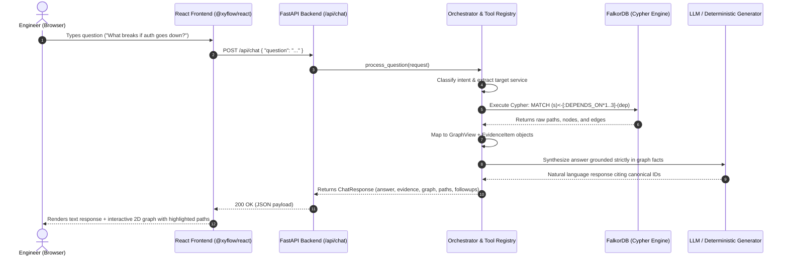
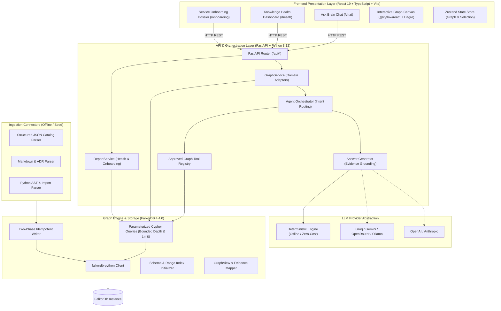
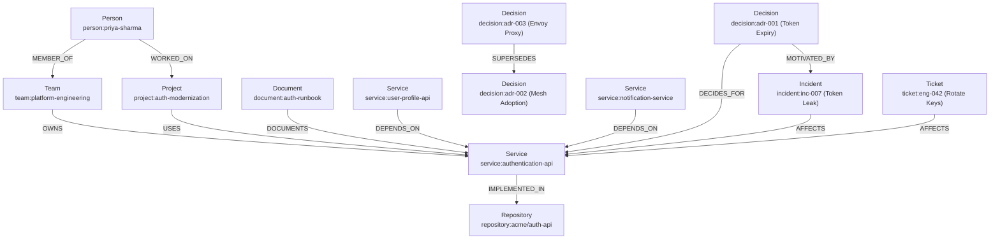
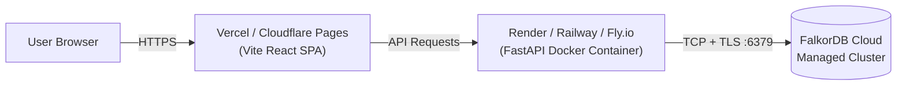

# WEAVE — Graph-Powered Engineering Knowledge Brain

[](https://falkordb.com/)
[](https://www.python.org/)
[](https://fastapi.tiangolo.com/)
[](https://react.dev/)
[](https://www.typescriptlang.org/)
[](https://vitejs.dev/)
[](LICENSE)

> **Track 03: Company Brain — FalkorDB Graph Hacks 2026**  
> An explainable, evidence-grounded engineering knowledge assistant powered by **FalkorDB**, **FastAPI**, and **React**. Ask questions about software architecture, navigate blast-radius impact trees, trace decision-to-incident lineage, discover cross-functional domain experts, and monitor organizational knowledge health on an interactive topological graph.

---

## Table of Contents

1. [Project Overview](#1-project-overview)
2. [Why FalkorDB is Essential](#2-why-falkordb-is-essential)
3. [Question-to-Answer Workflow](#3-question-to-answer-workflow)
4. [Features](#4-features)
5. [System Architecture](#5-system-architecture)
6. [Graph Data Model](#6-graph-data-model)
7. [Cypher Queries & Graph Traversals](#7-cypher-queries--graph-traversals)
8. [Prerequisites](#8-prerequisites)
9. [Complete Local Setup](#9-complete-local-setup)
10. [Environment Variables](#10-environment-variables)
11. [REST API Reference](#11-rest-api-reference)
12. [Testing & Validation](#12-testing--validation)
13. [Deployment Architecture](#13-deployment-architecture)
14. [Demo Walkthrough & Sample Questions](#14-demo-walkthrough--sample-questions)
15. [Limitations & Roadmap](#15-limitations--roadmap)
16. [AI Assistance Disclosure](#16-ai-assistance-disclosure)

---

## 1. Project Overview

Modern software engineering organizations suffer from chronic tribal knowledge fragmentation. Critical information is scattered across isolated silos:
- **System Architecture & Dependencies:** Documented in static diagrams that decay within months.
- **Service Ownership & Team Membership:** Tracked in outdated team catalogs or HR spreadsheets.
- **Architecture Decision Records (ADRs):** Buried in disparate GitHub repositories or wiki spaces.
- **Incident Post-Mortems:** Locked in Jira tickets and incident retrospective docs.
- **Code Repositories & Imports:** Hidden inside language-specific source code files.

When outages hit, on-call engineers struggle to answer: *"What services break if the authentication API goes down?"* When new engineers join, they ask: *"Who knows how the authentication pipeline works, and why do tokens expire in 24 hours?"*

**WEAVE** solves this by unifying engineering catalogs, ADRs, Git repositories, code imports, and incident retrospectives into a unified, low-latency property graph stored in **FalkorDB**. Every answer WEAVE produces is strictly grounded in graph traversal evidence, displaying explicit relationship paths, verifiable source citations, and a synchronized interactive 2D graph canvas.

---

## 2. Why FalkorDB is Essential

WEAVE is built fundamentally on FalkorDB—it is the computational backbone of the product, not a simple metadata cache:

1. **Microsecond Multi-Hop Traversals:** Blast-radius analysis requires traversing transitive dependency chains (`<-[:DEPENDS_ON*1..3]-`). Relational databases require expensive recursive CTEs and multiple joins; vector databases cannot model directed dependency chains at all. FalkorDB computes these multi-hop traversals in sub-millisecond time.
2. **GraphBLAS Linear Algebra Engine:** FalkorDB represents graph structures as sparse matrices and executes graph queries via matrix multiplication algorithms. This enables instantaneous shortest-path pathfinding (`find_shortest_path`) and bounded neighborhood expansions (`get_neighborhood`).
3. **Cypher Expressiveness:** Complex organizational questions—such as finding engineers who contributed to initiatives touching a specific service (`(:Person)-[:WORKED_ON]->(:Project)-[:USES]->(:Service)`)—are expressed as clear, declarative Cypher patterns.
4. **Idempotent Range-Indexed Identity:** Range indexes on `(n.id)` across all 11 entity types guarantee $O(1)$ node lookups and collision-free two-phase batch ingestion.

---

## 3. Question-to-Answer Workflow



---

## 4. Features

### Implemented & Verified Capabilities

- **Interactive Graph Canvas:** Built with `@xyflow/react` and Dagre hierarchical layout. Features automatic zoom-to-fit, entity type filtering (Services, Teams, People, Decisions, etc.), node detail inspector sidebar, and visual staleness indicators.
- **Evidence-Grounded Q&A:** Every answer links directly to verified graph nodes. Answers cite canonical identifiers (e.g., `service:authentication-api`, `incident:inc-007`) and relationship excerpts.
- **Cascading Blast-Radius Analysis:** Identifies all upstream caller services impacted by a potential outage using reverse dependency traversal (`<-[:DEPENDS_ON*1..3]-`).
- **Architectural Decision Lineage:** Discovers why decisions were made by querying `(:Decision)-[:DECIDES_FOR]->(:Service)`, tracing `[:MOTIVATED_BY]->(:Incident)`, and traversing `[:SUPERSEDES]->(:Decision)` chains with automatic supersession tagging.
- **Cross-Functional Expert Discovery:** Identifies domain experts by traversing engineer contributions: `(:Person)-[:WORKED_ON]->(:Project)-[:USES]->(:Service)`.
- **Topological Shortest-Path Finding:** Computes the shortest connecting relationship chain between any two arbitrary nodes in the company graph (up to 5 hops) via right-click or Ctrl-click on the graph canvas.
- **Knowledge Health & Governance Dashboard:** Automatically audits organizational knowledge completeness ($0-100\%$) across four key dimensions:
  1. *Service Ownership:* Percentage of services mapped to an owning team.
  2. *Decision Rationale:* Percentage of ADRs with recorded rationale.
  3. *Incident Resolution:* Percentage of tracked incidents marked as resolved.
  4. *Documentation Coverage:* Percentage of services with runbooks or documentation.
  Surfaces specific actionable gaps (unowned services, undocumented components, empty ADRs).
- **Service Onboarding Briefs:** Generates a comprehensive developer onboarding dossier for any service, aggregating owning team, key non-superseded decisions, active incidents, open tickets, lead engineers, and a localized topology graph.
- **Zero-Cost Deterministic Fallback Guardrails:** Runs 100% offline without third-party API keys or internet access using deterministic graph synthesis. Seamlessly connects to zero-cost free-tier providers (Groq `llama-3.1-8b-instant`, Google Gemini `gemini-1.5-flash`, OpenRouter free models, local Ollama) or commercial providers (OpenAI, Anthropic). Missing keys or API failures trigger graceful fallbacks without exposing secrets.

---

## 5. System Architecture



### Layer Responsibilities

1. **Ingestion Connectors (`weave_brain.ingestion`):** Parses raw JSON catalogs, Markdown ADRs, and Python repository source trees via `ast.parse()`. Emits validated `SourceArtifact` domain objects. Never executes raw Cypher directly.
2. **Graph Storage & Client (`weave_brain.graph`):** Manages the FalkorDB connection, ensures idempotent range indexes on `(n.id)`, handles two-phase node/edge upserts, executes parameterized Cypher queries, and maps database objects to Pydantic models.
3. **Agent & Orchestration (`weave_brain.agent`):** Manages question classification, invokes whitelisted graph tools, enforces traversal limits, extracts evidence paths, and synthesizes answers using either deterministic templates or configured LLM providers.
4. **FastAPI Application (`weave_brain.api`):** Exposes clean REST endpoints, handles CORS, enforces canonical identifier validation, logs failures without leaking credentials, and serves OpenAPI documentation.
5. **React Frontend (`frontend/src`):** Single-page application rendering the interactive canvas, chat interface, decision timelines, and knowledge health metrics. Consumes backend `GraphView` models directly.

---

## 6. Graph Data Model

WEAVE enforces a strict property graph schema. Every node has a canonical identifier following the formula:

$$\text{id} = \text{type}:\text{slug}$$

All slugs use lowercase alphanumeric characters with hyphens. File paths use forward slashes.

### 6.1 Node Types (11 Canonical Labels)

| Label | What it Represents | Required Properties | Optional Properties | Canonical Example ID |
| :--- | :--- | :--- | :--- | :--- |
| `Service` | A software microservice or system | `id`, `title` | `description`, `tech_stack`, `language`, `status` | `service:authentication-api` |
| `Team` | An engineering or product team | `id`, `title` | `description`, `slack_channel` | `team:platform-engineering` |
| `Person` | An individual engineer or lead | `id`, `title`, `source_type` | `email`, `role`, `slug` | `person:priya-sharma` |
| `Project` | An engineering initiative or roadmap epic | `id`, `title` | `description`, `status` | `project:auth-modernization` |
| `Decision` | An Architecture Decision Record (ADR) | `id`, `title`, `status` | `rationale`, `decision_date` | `decision:adr-001` |
| `Incident` | A production incident or outage | `id`, `title`, `severity` | `status`, `summary`, `resolved_at` | `incident:inc-007` |
| `Ticket` | An engineering backlog or tracking issue | `id`, `title`, `status` | `priority`, `summary` | `ticket:eng-042` |
| `Document` | Runbook, operational doc, or specification | `id`, `title` | `source_url`, `content_excerpt` | `document:auth-runbook` |
| `Repository`| A Git source code repository | `id`, `title`, `url` | `language`, `default_branch` | `repository:acme/auth-api` |
| `File` | A source code file in a repository | `id`, `title`, `content_hash` | `is_test`, `parse_error` | `file:acme/auth-api:src/tokens.py`|
| `Test` | An automated test suite or module | `id`, `title` | `framework`, `test_type` | `test:unit-auth-tokens` |

*Universal Node Properties:* All nodes also persist `source_id`, `source_type`, and `ingested_at` (ISO-8601 UTC timestamp).

### 6.2 Relationship Types (14 Whitelisted Edges)

| Relationship | Direction | Meaning | Edge Properties |
| :--- | :--- | :--- | :--- |
| `OWNS` | `(:Team)-[:OWNS]->(:Service)` | Team owns the software service | `source_id` |
| `MEMBER_OF` | `(:Person)-[:MEMBER_OF]->(:Team)` | Engineer is a member of the team | `source_id` |
| `MAINTAINS` | `(:Person)-[:MAINTAINS]->(:Service)` | Engineer directly maintains the service | `source_id` |
| `DEPENDS_ON` | `(:Service)-[:DEPENDS_ON]->(:Service)` | **Dependent points toward what it needs** | `criticality` |
| `IMPLEMENTED_IN`| `(:Service)-[:IMPLEMENTED_IN]->(:Repository)` | Service points toward its primary code repo | — |
| `CONTAINS` | `(:Repository)-[:CONTAINS]->(:File)` | Repository contains source code file | — |
| `IMPORTS` | `(:File)-[:IMPORTS]->(:File)` | **File A points toward File B that it imports** | — |
| `DECIDES_FOR` | `(:Decision)-[:DECIDES_FOR]->(:Service)` | ADR governs architecture of the service | — |
| `MOTIVATED_BY` | `(:Decision)-[:MOTIVATED_BY]->(:Incident)` | ADR was triggered by a production incident | — |
| `SUPERSEDES` | `(:Decision)-[:SUPERSEDES]->(:Decision)` | Newer ADR supersedes older ADR | — |
| `DOCUMENTS` | `(:Document)-[:DOCUMENTS]->(:Service)` | Runbook documents operational behavior | — |
| `AFFECTS` | `(:Incident\|:Ticket)-[:AFFECTS]->(:Service)` | Incident or ticket impacts the service | — |
| `WORKED_ON` | `(:Person)-[:WORKED_ON]->(:Project)` | Engineer contributed to an initiative | `role`, `period` |
| `USES` | `(:Project)-[:USES]->(:Service)` | Initiative touches or adopts the service | `since` |

> [!IMPORTANT]
> **Edge Direction Rule for Dependencies & Blast Radius:**  
> `(:Service A)-[:DEPENDS_ON]->(:Service B)` indicates that **A requires B**.  
> To determine what breaks if $B$ goes down (Blast Radius), we query incoming edges pointing **into** $B$:  
> `MATCH (s:Service {id: $sid})<-[:DEPENDS_ON*1..3]-(dep:Service)`

### 6.3 Representative Connected Subgraph



### 6.4 Schema Initialization & Two-Phase Ingestion

1. **Range Indexes (`weave_brain.graph.schema`):** During initialization, `init_schema(graph)` executes `CALL db.indexes()` and creates schema range indexes on `(n.id)` for all 11 node labels (`CREATE INDEX FOR (n:Service) ON (n.id)`). This guarantees sub-millisecond lookups.
2. **Two-Phase Ingestion (`weave_brain.graph.writer`):**
   - **Phase 1 (Node Upsert):** `MERGE (n:<Label> {id: $id}) SET n += $props` creates all nodes and strips reserved system keys.
   - **Phase 2 (Edge Upsert):** Matches both endpoints (`MATCH (a:<LabelA> {id: $src}), (b:<LabelB> {id: $dst}) MERGE (a)-[r:<REL>]->(b)`). If an endpoint is missing, the edge is safely skipped with a recorded warning. **No untyped phantom nodes are ever created.**

---

## 7. Cypher Queries & Graph Traversals

WEAVE uses strictly parameterized Cypher queries with bounded depth (max 3 hops) and bounded result sets (`LIMIT 50` or `LIMIT 100`).

### 1. Service Overview (`get_service_overview`)
- **Question Answered:** "Who owns the authentication service, what are its dependencies, linked decisions, and repositories?"
- **Cypher Traversal:**
  ```cypher
  MATCH (s:Service {id: $sid}) RETURN s;
  MATCH (t:Team)-[r:OWNS]->(s:Service {id: $sid}) RETURN t, r;
  MATCH (s:Service {id: $sid})-[r:IMPLEMENTED_IN]->(repo:Repository) RETURN repo, r;
  MATCH (d:Decision)-[r:DECIDES_FOR]->(s:Service {id: $sid}) RETURN d, r;
  MATCH (doc:Document)-[r:DOCUMENTS]->(s:Service {id: $sid}) RETURN doc, r;
  MATCH (dep:Service)-[r:DEPENDS_ON]->(s:Service {id: $sid}) RETURN dep, r;
  ```
- **Returns:** Service node, owning team, repos, ADRs, runbooks, and direct dependent services.

### 2. Cascading Blast Radius (`get_blast_radius`)
- **Question Answered:** "What breaks if the authentication service goes down?"
- **Graph Traversal:** Multi-hop reverse dependency traversal (1 to 3 hops) finding upstream caller services.
- **Cypher Traversal:**
  ```cypher
  MATCH path = (s:Service {id: $sid})<-[:DEPENDS_ON*1..3]-(dep:Service)
  RETURN path
  LIMIT 50;
  ```
- **Returns:** Complete paths of cascading dependent services. Visualized with highlighted red paths on the graph canvas.

### 3. Architecture Decision Lineage (`get_decisions_for_service`)
- **Question Answered:** "Why do authentication tokens expire, and was this decision motivated by an outage?"
- **Graph Traversal:** 1-to-2 hop inspection connecting ADRs to services, motivating incidents, and superseding ADRs.
- **Cypher Traversal:**
  ```cypher
  MATCH (d:Decision)-[r:DECIDES_FOR]->(s:Service {id: $sid})
  OPTIONAL MATCH (d)-[m:MOTIVATED_BY]->(inc:Incident)
  OPTIONAL MATCH (newer:Decision)-[sup:SUPERSEDES]->(d)
  OPTIONAL MATCH (d)-[sup_out:SUPERSEDES]->(older:Decision)
  RETURN d, r, inc, m, newer, sup, older, sup_out
  LIMIT 50;
  ```
- **Returns:** ADRs with rationale, motivating incident context (`incident:inc-007`), and superseding decision chains.

### 4. Expert Discovery (`find_experts`)
- **Question Answered:** "Who are the domain experts for the authentication API?"
- **Graph Traversal:** 2-hop traversal connecting engineers to services through initiatives they executed.
- **Cypher Traversal:**
  ```cypher
  MATCH (p:Person)-[w:WORKED_ON]->(proj:Project)-[:USES]->(s:Service {id: $sid})
  OPTIONAL MATCH (p)-[:MEMBER_OF]->(t:Team)
  RETURN p, w, proj, t
  LIMIT 50;
  ```
- **Returns:** Qualified engineers (`person:priya-sharma`, `person:james-chen`), their roles, project timeframe, and team affiliation.

### 5. Shortest Path & Connection Finding (`find_shortest_path`)
- **Question Answered:** "How is Priya Sharma connected to the Authentication API?"
- **Graph Algorithm:** Breadth-First Search (BFS) pathfinding up to 5 hops between any two entity nodes.
- **Cypher Traversal:**
  ```cypher
  MATCH (a {id: $from_id}), (b {id: $to_id})
  MATCH path = (a)-[*1..5]-(b)
  RETURN path
  ORDER BY length(path) ASC
  LIMIT 1;
  ```
- **Returns:** The minimal topological path linking source and target, highlighted across canvas nodes and edges.

### 6. Bounded Neighborhood Exploration (`get_neighborhood`)
- **Question Answered:** Double-clicking any entity node on the canvas to fetch its 1-or-2-hop surrounding neighborhood.
- **Cypher Traversal:**
  ```cypher
  MATCH path = (center {id: $nid})-[*1..2]-(neighbor)
  RETURN path
  LIMIT 50;
  ```
- **Returns:** Bounded subgraph merged into the active canvas without re-querying the whole graph.

### 7. Governance Health Scoring (`get_health_score`)
- **Question Answered:** "What is the organization's knowledge health score?"
- **Graph Aggregations:** Computes ratios across 4 organizational dimensions:
  ```cypher
  -- Service ownership ratio
  MATCH (s:Service) RETURN count(s);
  MATCH (:Team)-[:OWNS]->(s:Service) RETURN count(DISTINCT s);

  -- Decision rationale completeness
  MATCH (d:Decision) RETURN count(d);
  MATCH (d:Decision) WHERE d.rationale IS NOT NULL AND d.rationale <> '' RETURN count(d);

  -- Incident resolution rate
  MATCH (inc:Incident) RETURN count(inc);
  MATCH (inc:Incident {status: 'resolved'}) RETURN count(inc);

  -- Documentation coverage
  MATCH (:Document)-[:DOCUMENTS]->(s:Service) RETURN count(DISTINCT s);
  ```

### 8. Knowledge Gap Detection (`get_knowledge_gaps`)
- **Question Answered:** Surfaces specific architectural orphans and governance risks.
- **Cypher Traversal:**
  ```cypher
  -- Unowned services (Missing Team)
  MATCH (s:Service) WHERE NOT ()-[:OWNS]->(s) RETURN s;

  -- Decisions without rationale
  MATCH (d:Decision) WHERE d.rationale IS NULL OR d.rationale = '' RETURN d;

  -- Undocumented services (Missing Document)
  MATCH (s:Service) WHERE NOT ()-[:DOCUMENTS]->(s) RETURN s;
  ```

---

## 8. Prerequisites

Ensure your environment meets these tool and version requirements:

- **Docker & Docker Desktop:** For running FalkorDB container (`docker compose` v2+).
- **Python:** Version `3.12` or `3.13` (tested and verified).
- **uv:** Modern fast Python package manager (`pip install uv`). Alternatively, standard Python `venv` + `pip`.
- **Node.js:** `>= 22.12.0` (tested on Node 22 and 24).
- **npm:** Included with Node.js. (On Windows PowerShell, use `npm.cmd` to bypass execution policy restrictions).
- **Ports Available:** `6379` (FalkorDB), `8000` (FastAPI backend), `5173` (Vite frontend).

---

## 9. Complete Local Setup

Follow these verified steps to run the complete WEAVE stack locally.

### Windows (PowerShell)

```powershell
# 1. Clone repository
git clone https://github.com/satwik-kumar/WEAVE.git
cd WEAVE

# 2. Configure environment files
Copy-Item .env.example .env
Copy-Item frontend\.env.example frontend\.env

# 3. Start local FalkorDB container
docker compose up -d falkordb

# 4. Install backend dependencies (using uv)
cd backend
python -m uv sync --frozen
cd ..

# 5. Seed the fictional demo graph into FalkorDB
.\backend\.venv\Scripts\python.exe scripts/seed_demo.py

# 6. Validate the demo graph integrity
.\backend\.venv\Scripts\python.exe scripts/validate_demo.py

# 7. Start FastAPI Backend (Terminal 1)
cd backend
.\.venv\Scripts\python.exe -m weave_brain.api
# Backend will be live at http://localhost:8000 (OpenAPI docs: http://localhost:8000/docs)

# 8. Install frontend dependencies & start Vite server (Terminal 2)
cd frontend
npm.cmd ci
npm.cmd run dev
# Frontend will be live at http://localhost:5173
```

### macOS / Linux (Bash)

```bash
# 1. Clone repository
git clone https://github.com/satwik-kumar/WEAVE.git
cd WEAVE

# 2. Configure environment files
cp .env.example .env
cp frontend/.env.example frontend/.env

# 3. Start local FalkorDB container
docker compose up -d falkordb

# 4. Install backend dependencies (using uv)
cd backend
uv sync --frozen
cd ..

# 5. Seed the fictional demo graph
./backend/.venv/bin/python scripts/seed_demo.py

# 6. Validate the demo graph integrity
./backend/.venv/bin/python scripts/validate_demo.py

# 7. Start FastAPI Backend (Terminal 1)
cd backend
./.venv/bin/python -m weave_brain.api

# 8. Install frontend dependencies & start Vite server (Terminal 2)
cd frontend
npm ci
npm run dev
```

### Troubleshooting Common Setup Issues

- **Port 6379 in use:** If an existing Redis instance occupies port 6379, stop it with `docker stop <container>` or adjust `ports` in `docker-compose.yml` and update `FALKORDB_PORT` in `.env`.
- **PowerShell Script Execution Policy:** If `npm` commands fail with execution policy errors, use `npm.cmd` instead.
- **FalkorDB Connection Timeout:** Confirm the Docker container is healthy (`docker ps`). Test raw connectivity with `docker exec -it weave-falkordb-1 redis-cli ping`.
- **Zero-Cost / Offline Verification:** If you do not have an LLM API key, leave `LLM_PROVIDER=deterministic` in `.env`. WEAVE functions with 100% feature completeness in deterministic retrieval mode.

---

## 10. Environment Variables

### Backend Configuration (`.env`)

| Variable Name | Required | Default Value | Description / Safe Example |
| :--- | :---: | :--- | :--- |
| `FALKORDB_HOST` | **Yes** | `localhost` | Hostname of the FalkorDB instance (`localhost` or `127.0.0.1`). |
| `FALKORDB_PORT` | **Yes** | `6379` | Port number of FalkorDB (must be integer `1-65535`). |
| `FALKORDB_GRAPH_NAME` | **Yes** | `repocompass_brain` | Graph namespace to store and query entities. |
| `FALKORDB_USERNAME` | No | *(empty)* | Optional Redis/FalkorDB username. |
| `FALKORDB_PASSWORD` | No | *(empty)* | Optional Redis/FalkorDB password. |
| `FALKORDB_SSL` | No | `false` | Enable TLS/SSL connection with certificate validation. |
| `FALKORDB_TIMEOUT` | No | `5` | Database socket query timeout in seconds (`1-30`). |
| `HOST` | No | `0.0.0.0` | Server bind host address. |
| `PORT` | No | `8000` | Server bind port. |
| `ALLOWED_ORIGINS` | **Yes** | `http://localhost:5173` | Comma-separated list or JSON array of allowed CORS web origins. |
| `DEVELOPMENT_FIXTURES` | No | `false` | Set to `true` to use zero-database offline catalog fixtures. |
| `CHAT_MODE` | No | `retrieval` | Mode selection: `retrieval` (deterministic) or `agent` (LLM-assisted). |
| `LLM_PROVIDER` | No | `deterministic` | Provider: `deterministic`, `groq`, `gemini`, `openrouter`, `ollama`, `anthropic`, `openai`. |
| `LLM_MODEL` | No | *(auto)* | Model name (e.g. `llama-3.1-8b-instant`, `gemini-1.5-flash`, `gpt-4o-mini`). |
| `LLM_API_KEY` | No | *(empty)* | Generic API key fallback for selected provider. |
| `GROQ_API_KEY` | No | *(empty)* | Specific key for Groq free tier. |
| `GEMINI_API_KEY` | No | *(empty)* | Specific key for Google Gemini free tier. |
| `OPENROUTER_API_KEY` | No | *(empty)* | Specific key for OpenRouter free models. |
| `OPENAI_API_KEY` | No | *(empty)* | Commercial key for OpenAI models. |
| `ANTHROPIC_API_KEY` | No | *(empty)* | Commercial key for Anthropic Claude models. |
| `LLM_TIMEOUT` | No | `20` | HTTP request timeout for LLM provider calls. |

### Frontend Configuration (`frontend/.env`)

| Variable Name | Required | Default Value | Description |
| :--- | :---: | :--- | :--- |
| `VITE_API_BASE_URL` | **Yes** | `http://localhost:8000` | Backend API base URL without trailing `/api`. Compiled into public bundle. |

> [!WARNING]
> Never place secrets or database passwords in `frontend/.env` or any `VITE_*` variable. All Vite variables are publicly accessible in client JavaScript bundles.

---

## 11. REST API Reference

Base URL: `http://localhost:8000`  
OpenAPI Documentation: `http://localhost:8000/docs`

| Method | Endpoint | Description | Input Params / Body | Status Codes |
| :--- | :--- | :--- | :--- | :---: |
| `GET` | `/api/live` | Health liveness probe | None | `200` |
| `GET` | `/api/health` | Service readiness probe (checks DB) | None | `200`, `503` |
| `POST` | `/api/chat` | Submit question to knowledge assistant | `ChatRequest` (`question`, `conversation_id`) | `200`, `400`, `503` |
| `GET` | `/api/services/{service_id}` | Retrieve complete service overview | Path: `service_id` | `200`, `404` |
| `GET` | `/api/services/{service_id}/blast-radius`| Cascading dependency impact analysis | Path: `service_id`, Query: `max_depth` (1-3) | `200`, `404` |
| `GET` | `/api/services/{service_id}/decisions` | Decisions governing a service | Path: `service_id` | `200`, `404` |
| `GET` | `/api/graph/neighborhood/{node_id}` | Bounded entity neighborhood subgraph | Path: `node_id`, Query: `depth` (1-3) | `200`, `404` |
| `GET` | `/api/graph/shortest-path` | Shortest path between two entities | Query: `from_id`, `to_id` | `200`, `400` |
| `GET` | `/api/search` | Case-insensitive entity search | Query: `q` | `200`, `400` |
| `GET` | `/api/entities/{node_id}` | Single entity node metadata | Path: `node_id` | `200`, `404` |
| `GET` | `/api/health-score` | Overall governance score & 4 metrics | None | `200` |
| `GET` | `/api/reports/knowledge-gaps` | Actionable unowned/undocumented gaps | None | `200` |
| `GET` | `/api/reports/onboarding/{service_id}` | Developer onboarding dossier | Path: `service_id` | `200`, `404` |

### Representative API Payloads

#### `POST /api/chat` (Request)
```json
{
  "question": "What breaks if the authentication service goes down?"
}
```

#### `POST /api/chat` (Response)
```json
{
  "message_id": "4b7f0e3e-63f2-46fa-90f7-ebf3c7e73523",
  "answer": "**Authentication API (`service:authentication-api`) Blast Radius Analysis**\n\nIf `service:authentication-api` experiences an outage, 2 downstream services will be directly impacted:\n\n1. **User Profile API** (`service:user-profile-api`)\n   - Owned by: `team:backend-core`\n   - Traversal depth: 1 hop\n2. **Notification Service** (`service:notification-service`)\n   - Owned by: `team:platform-engineering`\n   - Traversal depth: 1 hop",
  "evidence": [
    {
      "source_id": "service:user-profile-api",
      "title": "User Profile API",
      "source_type": "service",
      "excerpt": "Depends on service:authentication-api (criticality: high)",
      "relationship_path": ["service:user-profile-api", "service:authentication-api"]
    }
  ],
  "graph": {
    "nodes": [
      {
        "id": "service:authentication-api",
        "type": "service",
        "title": "Authentication API",
        "properties": { "status": "production", "tech_stack": "FastAPI, FalkorDB" },
        "on_highlighted_path": true
      },
      {
        "id": "service:user-profile-api",
        "type": "service",
        "title": "User Profile API",
        "properties": { "status": "production" },
        "on_highlighted_path": true
      }
    ],
    "edges": [
      {
        "id": "service:user-profile-api::DEPENDS_ON::service:authentication-api",
        "source_id": "service:user-profile-api",
        "target_id": "service:authentication-api",
        "relationship_type": "DEPENDS_ON",
        "label": "DEPENDS_ON"
      }
    ],
    "highlighted_path_ids": [
      "service:user-profile-api::DEPENDS_ON::service:authentication-api"
    ]
  },
  "suggested_followups": [
    "Who are the experts for authentication-api?",
    "What architectural decisions govern authentication-api?",
    "View complete onboarding dossier for authentication-api"
  ],
  "warnings": [],
  "intent": "get_blast_radius"
}
```

---

## 12. Testing & Validation

WEAVE enforces rigorous unit, integration, and end-to-end verification.

### Run All Validation Checks

```powershell
# 1. Validate Demo Data Catalog (Developer A checklist)
.\backend\.venv\Scripts\python.exe scripts/validate_demo.py
# Result: 12/12 checks passed (19/19 frozen entities verified)

# 2. Run Backend Python Unit Tests (174 tests)
.\backend\.venv\Scripts\python.exe -m pytest backend/tests/unit/ -v
# Result: 174 passed, 1 warning in ~30.7s

# 3. Check Python Code Quality & Formatting
cd backend
.\.venv\Scripts\ruff.exe check .
# Result: All checks passed (0 errors)
cd ..

# 4. Run Frontend Unit Tests (Vitest Store Suite)
cd frontend
npm.cmd test
# Result: 8/8 tests passed in 741ms

# 5. Check Frontend Linting (Oxlint)
npm.cmd run lint
# Result: 0 warnings, 0 errors across 35 files

# 6. Production Frontend Build
npm.cmd run build
# Result: tsc -b && vite build passed in 752ms
cd ..
```

### Integration Tests with Live FalkorDB

Backend integration tests create isolated temporary graphs on FalkorDB and verify index creation, pathfinding, and writer operations:

```powershell
$env:FALKORDB_AVAILABLE="1"
$env:FALKORDB_HOST="127.0.0.1"
$env:FALKORDB_PORT="6379"
$env:FALKORDB_GRAPH_NAME="weave_integration_test"
.\backend\.venv\Scripts\python.exe -m pytest backend/tests/ -v
```

---

## 13. Deployment Architecture

WEAVE supports flexible deployment options:



1. **Frontend Deployment:** Deploy `frontend/` as a static SPA on Vercel or Cloudflare Pages. Set `VITE_API_BASE_URL` to the public backend origin.
2. **Backend Deployment:** Deploy `backend/` using the included production container configuration (`render.yaml`).
3. **FalkorDB Cluster:** Connect to a managed FalkorDB Cloud instance using `FALKORDB_HOST`, `FALKORDB_PORT`, `FALKORDB_PASSWORD`, and `FALKORDB_SSL=true`.
4. **Local Fallback Assurance:** If cloud deployment is inaccessible during evaluation, reviewers can run the complete stack locally using Docker Desktop in under 2 minutes.

---

## 14. Demo Walkthrough & Sample Questions

### 1. Test Questions in "Ask Brain"

Open `http://localhost:5173` and submit these questions:

- **Service Ownership:** *"Who owns the authentication service?"*
  - *Expected Graph:* Highlights `team:platform-engineering` connected via `OWNS` to `service:authentication-api`.
- **Cascading Blast Radius:** *"What breaks if the authentication service goes down?"*
  - *Expected Graph:* Red highlighted paths showing `service:user-profile-api` and `service:notification-service` pointing into `service:authentication-api`.
- **Decision Lineage & Motivating Incidents:** *"Why do authentication tokens expire?"*
  - *Expected Graph:* Highlights `decision:adr-001` (Token Expiry 24h Policy) linked to `service:authentication-api` via `DECIDES_FOR` and `incident:inc-007` (Stolen long-lived token exploited) via `MOTIVATED_BY`.
- **Expert Discovery:** *"Who are the authentication experts?"*
  - *Expected Graph:* Connects `person:priya-sharma` and `person:james-chen` through `project:auth-modernization` to `service:authentication-api`.
- **Shortest Path Finding:** Right-click `person:priya-sharma`, then select `service:authentication-api`.
  - *Expected Result:* Traces the 2-hop connection through `project:auth-modernization`.

### 2. Knowledge Health Governance (`/health`)

Navigate to the **Health** tab to view the live governance audit:
- **Overall Score:** Computed from the 4 live graph metrics.
- **Intentional Knowledge Gaps:**
  - *Unowned Service:* Identifies `service:data-pipeline` (has no owning team).
  - *Missing Rationale:* Identifies `decision:adr-002` (Service mesh adoption has empty rationale; superseded by `adr-003`).

### 3. Service Onboarding (`/onboarding`)

Navigate to the **Onboarding** tab and select `service:authentication-api`:
- Reviews the complete briefing dossier: lead maintainers, accepted non-superseded decisions (`adr-001`), dependent service risks, open incidents, and linked tickets (`ticket:eng-042`).

---

## 15. Limitations & Roadmap

### Confirmed Limitations
- **Ingestion Scope:** Automated AST code ingestion currently supports Python repositories (`.py` files).
- **Single-Turn Context:** The backend agent currently operates on single-turn question-answering with suggested follow-up prompts, without persisting conversational history across browser sessions.
- **Traversal Horizon:** Bounded graph traversals enforce a safety limit of 3 hops (and 5 hops for shortest paths) to guarantee sub-millisecond response guarantees.

### Future Roadmap
- [ ] Polyglot AST ingestion connectors for TypeScript, Go, and Rust repositories via Tree-sitter.
- [ ] Real-time GitHub / GitLab Webhook integrations to ingest PRs and ADR updates continuously.
- [ ] Multi-turn conversational memory persisted within FalkorDB user session subgraphs.
- [ ] Proactive Slack bot integration for automated incident blast-radius alerts during triage.

---

## 16. AI Assistance Disclosure

In accordance with hackathon guidelines, AI coding assistants (Google Antigravity and Claude/Codex) were utilized during the development of WEAVE for:
- Initial boilerplate scaffolding and test file generation.
- Formulating Cypher query syntax examples and Pydantic validation tests.
- Auditing TypeScript interfaces against backend domain models.

All architectural designs, Cypher query patterns, graph schema directions, multi-hop traversal logic, two-phase idempotent writer implementations, and integration test suites were designed, supervised, and rigorously verified by the project authors.
